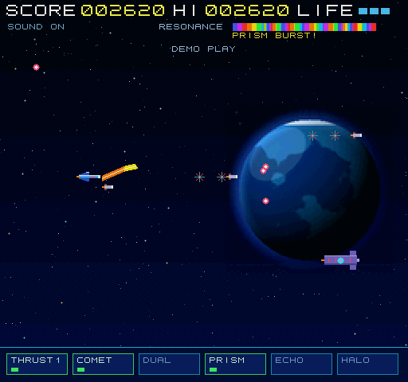

[English](README.en.md) | [日本語](README.md)

# LUMINA SERPENT for X68000



**[Launch LUMINA SERPENT in WebX68k](https://uraraworks.github.io/WebX68k/?fd1=https://raw.githubusercontent.com/renatus-novus-x/luminaserpent/main/dist/luminaserpent.xdf&run=1)**

An original horizontal-scrolling shooter for the Sharp X68000, written
in C++ with the elf2x68k cross toolchain (m68k-xelf-gcc/g++). It boots
standalone — **no Human68k required**: the game itself is the system
file (`luminaserpent.sys`, built hellosys-style), placed on the disk as
`HUMAN.SYS` so the X68000 IPL loads it directly.

The main README is in Japanese: [README.md](README.md).

## The game

Pilot the light-serpent fighter through a stage in deep space, with a
planet Earth hanging behind the boss. The signature weapon is the
**Light-Serpent laser**: hold the shot button and steer, and the beam
follows your flight path like a serpent, shifting color across the
spectrum — cyan, green, violet, gold — with its curvature. Bending the
beam charges the RESONANCE gauge; at full charge it erupts into the
wide, rainbow **PRISM BURST**. At the end of the stage waits the
**ABYSS PRISM LEVIATHAN**, a crystal boss whose core is shielded by
four orbiting prism shards — the core cannot be hurt until every shard
is shattered. Its defeat plays out as a long explosion barrage with a
rising screen shake, a final blast, and a full-screen whiteout.

Power-ups are items dropped by destroyed enemies — fly into one to
equip it instantly (the bottom strip shows your current loadout):
**THRUST** (speed up), **COMET** (homing side shots), **DUAL** (twin
diagonal shots), **PRISM** (the serpent laser), **ECHO** (option
drones), **HALO** (shield), plus bonus stars.

## Features

- 512×480, 65536 colors (CRTMOD 12), CRT controller retimed in the
  vertical blank to ≈60 Hz; frame pacing locked to the VDISP signal
  (MFP GPIP) for flicker-free play
- Everything on screen — ship, options, enemies, boss, bullets,
  particles, items — is hardware sprites written straight to sprite
  RAM; the laser alone is drawn into GVRAM (with a static-chain skip
  and fixed-point runs, a steady beam holds F53–60)
- Deep-space background: gradient, faint nebulae, 380 stars, and a big
  Earth (about 1/3 of the screen) with procedural continents, cloud
  bands, a polar cap and an atmosphere rim. The planet is pre-rendered
  into a tile on the host (`earth_bg.h`) — generating it on a 68000 at
  boot took minutes, so the machine only blits it
- YM2151 (OPM) sound driven directly via IOCS, with three BGM
  patterns switched by scene: a quiet ambient theme on the title
  (slow tempo, long floating tones), an active 8th-note arpeggio
  theme in game, and a driving synthwave boss theme; sound effects
  and jingles on separate channels
- Attract mode: leave the title screen alone for about 5 seconds and
  an AI demo game starts (invincible, can finish the boss; any key
  returns to the title, demo scores never touch the hi-score)
- 8×8 dot font: "8x8 ORIGINAL FONT 1 fix" from the MSXPen shared code
  (https://msxpen.com/codes/-Nq8q6wabU6mJ4onDmYE), glyphs for ASCII
  0x20–0x7F
- Keyboard and joystick/joypad (port 1) support

## Controls

| Input | Action |
|---|---|
| Cursor keys / WASD / joypad | Move |
| Z / SPACE / pad button (hold) | Shot — hold for the serpent laser |
| P | Pause |
| M | Sound on/off |
| ESC | Back to title (on title: exit) |

## Building

Requirements: the elf2x68k toolchain (`m68k-xelf-g++`) on your PATH,
plus Python 3 for the disk-image scripts.

```
make            # luminaserpent.sys (bootable system) + luminaserpent.x (Human68k .X)
make boot       # luminaserpent.xdf  — standalone boot disk image
make xdisk      # luminaserpent-x.xdf — Human68k disk, AUTOEXEC runs the .X
make test       # luminaserpent-test.xdf — verification build (see README.md)
```

The `.xdf` targets need a Human68k 3.02 disk image as a template.
That image is **not** part of this repository — supply your own:

```
make boot HUMAN68K_XDF=/path/to/human302.xdf
```

(or pass the path as the third argument to the Python scripts, or set
the `HUMAN68K_XDF` environment variable.)

The Earth tile `earth_bg.h` is committed, so the game builds as-is.
To regenerate it (e.g. after changing the background generator), run
`python3 tools/gen_earth_tile.py` — it compiles `tools/earth_gen.cpp`
(the game's own background bake) on the host, renders the background,
and emits the tile header.

## Running

- Emulator: load `dist/luminaserpent.xdf` (included, 2HD, 1,261,568 bytes) as FDD0
  and boot. In [WebX68k](https://uraraworks.github.io/WebX68k/),
  insert the image and use the "boot with the inserted disk" button.
  The title appears after a few seconds (a LOADING… note shows while
  the background is prepared).
- Real hardware: write the image to a 2HD floppy and boot from it.

## Files

| File | Description |
|---|---|
| `luminaserpent.cpp` | The whole game (single-file C++) |
| `earth_bg.h` | Pre-rendered Earth tile (105×105, GRB555) |
| `Makefile` | Build rules (see above) |
| `tools/make_boot_xdf.py` | Builds the standalone boot disk (game as HUMAN.SYS) |
| `tools/make_x_xdf.py` | Builds the Human68k disk with the .X executable |
| `tools/earth_gen.cpp` | Host build of the background generator (asset tool) |
| `tools/gen_earth_tile.py` | Renders the background and emits `earth_bg.h` |
| `README.md` | Japanese README (main) with design and optimization notes |
| `dist/luminaserpent.xdf` | Bootable disk image (included) |
| `images/teaser.png` | Teaser screenshot |
